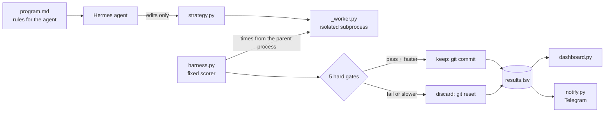
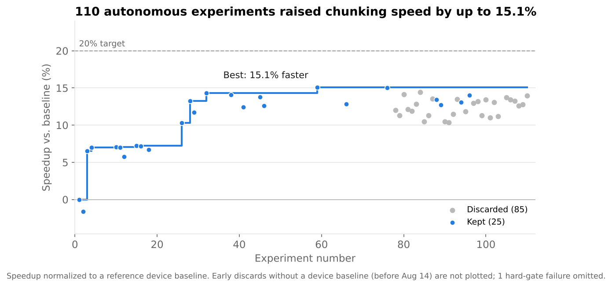

# RAG Chunking AutoResearch

An autonomous experiment loop that optimizes the chunking stage of a RAG pipeline. An AI agent (Hermes) rewrites the chunking strategy, a fixed harness scores every attempt, and only changes that are faster **and** pass every content-quality gate are kept.

The design follows Karpathy's *autoresearch* pattern: the agent may edit exactly one file, the scoring code is out of its reach, and every attempt is logged, kept or rolled back by git.

The chunker under test is a simplified port of the `structured_600_100` strategy from the [AI Energy Operations Copilot](https://github.com/YOYU001/ai-energy-operations-copilot-1), run on 4 energy research PDFs.

---

## How it works



| File | Role |
|---|---|
| `tools/chunking_autoresearch/strategy.py` | The only file the agent may edit |
| `tools/chunking_autoresearch/harness.py` | Fixed scorer: parses the PDFs, runs the strategy, applies the gates, reports `cost_time` |
| `tools/chunking_autoresearch/_worker.py` | Runs `strategy.chunk()` in a separate process so it cannot touch the harness timer |
| `tools/chunking_autoresearch/program.md` | Operating rules and the experiment loop the agent follows |
| `tools/chunking_autoresearch/dashboard.py` | Local dashboard of every experiment, trend and gate status |
| `tools/chunking_autoresearch/notify.py` | Telegram progress alerts and the 20% stop-threshold check |
| `tools/chunking_autoresearch/mcp_server.py` | MCP tools for querying experiment results from a coding agent |

---

## Anti-cheating hard gates

Speed only counts when all five gates pass. A failed gate pushes `cost_time` above 1000, so it always loses to an honest strategy.

| Gate | Threshold | Blocks |
|---|---|---|
| Assembly accuracy | 100% of chunks valid | Malformed or truncated chunks, cut-off tables |
| Content coverage | ≥ 90% of source text kept (30-character shingles) | Speed gained by dropping data |
| Chunk share | No chunk > 50% of its document | Packing a whole document into one chunk |
| Chunk length | No chunk > 2,000 characters | Splitting naively in halves |
| Redundancy | Overlap ratio ≤ 0.4 | Over-fragmented, heavily duplicated splits |

The first version had only format checks. An independent review found that a strategy which dropped most of the content scored better than the baseline; the coverage, share, length and redundancy gates were added to close those loopholes.

---

## Measurement integrity

- **Isolated timing.** The parent process measures time; the strategy runs in a child process. A QA review found that importing `strategy.py` into the harness let module-level code replace the timer and fake `cost_time: 0.000000`. The harness now reads the strategy name from source text and never imports it.
- **Device baseline.** NAS load changes from day to day, so every session first re-measures the original baseline and normalizes all timings to a reference device state. Sessions more than 15% off the reference are flagged.
- **Same-session comparison.** Keep/discard compares against a baseline re-measured in the same session, with 5 repeats, because many real effects (1-2%) are as small as machine noise.
- **Profiling the harness itself.** `python -X importtime` showed that re-spawning a subprocess per repeat took 88.6% of measured time and the strategy only 5.97%. The worker became a persistent process, with an explicit rebaseline so old and new numbers are never compared.

---

## Results

The agent ran nightly on a NAS on 22 days between Aug 10 and Sep 1, 2026, with Telegram progress alerts: **110 experiments, 25 kept and 85 discarded**, reaching a best speedup of **15.1%** over the baseline with every quality gate passing. The loop is paused: the speedup plateaued at 14-15%, short of the 20% target, because the logic `strategy.py` can change is a small part of total processing time.



Raw log of every run: [results/chunking_autoresearch_results.tsv](results/chunking_autoresearch_results.tsv) (the `description` column is the agent's original note, in Traditional Chinese).

Best changes found, all verified output-identical to the previous version:

| Change | Measured effect |
|---|---|
| Track sentence spans with `finditer()` and integer indices instead of materializing strings | ~10% faster split step |
| Merge two passes in `_split_oversized` into one loop | further 15-35% |
| Skip rebuilding the piece list when no piece exceeds the limit | ~12% |
| `str.join()` over a list comprehension instead of a generator | ~30% in a micro-benchmark |
| Cheap string checks before regex calls; non-capturing groups; local-variable caching | small, cumulative |
| `CHUNK_SIZE` 600 → 1500 with overlap 100 → 75 | far fewer chunks to serialize and store |

Full write-up: [docs/chunking_autoresearch_findings_for_mvp1_2026-09-02.md](docs/chunking_autoresearch_findings_for_mvp1_2026-09-02.md). Background research on chunking evaluation metrics: [docs/rag_chunking_evaluation_metrics_research.md](docs/rag_chunking_evaluation_metrics_research.md).

---

## Quick start

```bash
pip install -r requirements.txt

# score the current strategy once
python tools/chunking_autoresearch/harness.py

# open the dashboard at http://127.0.0.1:8765/
python tools/chunking_autoresearch/dashboard.py
```

Example harness output (baseline):

```text
cost_time:         0.988424
quality_pass_rate: 1.000000
content_coverage:  0.999582
hard_gate_passed:  True
num_chunks:        257
strategy_name:     baseline_structured_600_100
```

To run the agent loop, point a Hermes session at this repository and follow `tools/chunking_autoresearch/program.md`.

---

## Repository structure

```text
tools/chunking_autoresearch/   harness, strategy, worker, dashboard, notifier, MCP server
docs/                          findings report, chunking-metrics research, test documents
datasets/                      retrieval test questions and baselines from the energy copilot
results/                       full experiment log (results.tsv)
.claude/                       agents, rules and skills used during development
```

## Scope

This loop measures chunking speed and structural quality only. Retrieval accuracy is not measured here; any parameter change (for example `CHUNK_SIZE`) must be re-validated against the copilot's retrieval benchmark before adoption.
